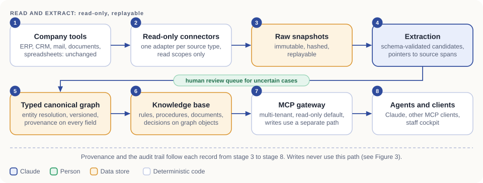
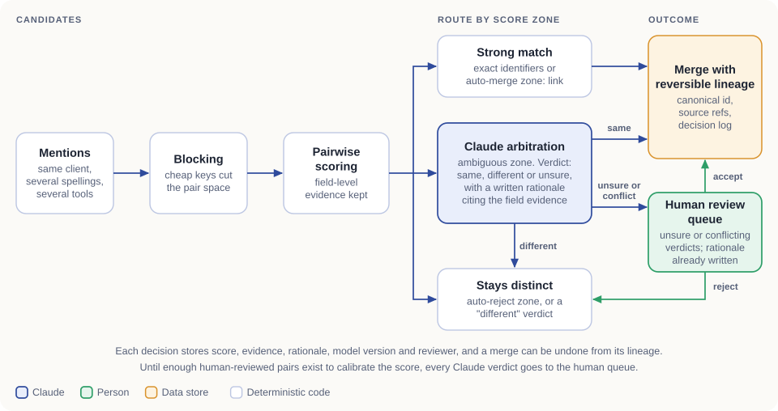
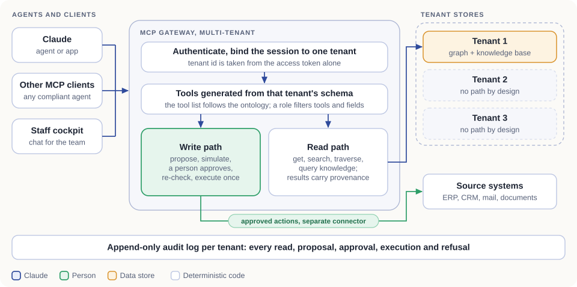

# Socle Twin architecture

> How Socle Twin builds, updates and serves an ontology-first digital twin of a small company, and where Claude does the work.

*Version 1, October 2026. The same content as [getsocle.com/architecture](https://getsocle.com/architecture), with the diagrams as files in [`docs/`](docs/).*

## Contents

1. [Summary](#1-summary)
2. [Data path: from source system to agent](#2-data-path-from-source-system-to-agent)
3. [Ontology-first model](#3-ontology-first-model)
4. [Entity resolution](#4-entity-resolution)
5. [Provenance per field, versions validated by people](#5-provenance-per-field-versions-validated-by-people)
6. [Knowledge base](#6-knowledge-base)
7. [MCP gateway, multi-tenant](#7-mcp-gateway-multi-tenant)
8. [Evals: replayed on every new model](#8-evals-replayed-on-every-new-model)
9. [Where Claude sits at each step](#9-where-claude-sits-at-each-step)
10. [Today and 2027](#10-today-and-2027)
11. [Open questions we are working on with Claude](#11-open-questions-we-are-working-on-with-claude)

## 1. Summary

Socle Twin is an ontology-first digital twin of a small or mid-sized company. It has two parts that point at each other. A typed graph holds what the company is: clients, projects, invoices, people, documents and the links between them. A structured knowledge base holds how it works: rules, procedures, source documents and decisions, attached to the graph objects they govern.

Ingestion connectors read the tools the company already runs, with read-only credentials. Claude does the reading, typing and matching, and people validate what matters. Any agent, Claude or another, reaches the twin through one multi-tenant MCP gateway. The gateway is read-only by default: a write exists only as a proposed action that a person approves.

The company's tools stay the system of record. Each value carries its provenance, each version is dated and validated by a person, and each answer cites its sources or states what is missing.

- **Closed typology.** A finite, versioned set of object and link types per company. Extraction emits only what the schema allows.
- **Read-only ingestion.** Ingestion connectors hold read credentials only. Any write takes a separate path and starts after a person approves.
- **Provenance per field.** Source, method, validity dates and validation status travel with each value.
- **Reversible.** Merges, versions and model switches keep their lineage, so each can be audited or undone.

## 2. Data path: from source system to agent

The path has eight stages and runs in one direction. Ingestion is read-only, so no stage after the connectors can write to a source system. Any write goes through a separate, approval-gated path (section 7). Each stage replays from the one before it. When a source changes, a new snapshot produces a new graph version (section 5).

*Figure 1. The data path. Blue marks steps where a model runs, green marks people, amber marks data stores.*

| Stage | How it works | Invariant |
|---|---|---|
| 1. Company tools | ERP, CRM, mail, documents and spreadsheets remain the system of record. | The twin build never modifies a source system. |
| 2. Read-only connectors | One adapter per source type sits behind a replaceable interface, with a conversion contract per type. Credentials are read-only. | No business object mirrors a single connector row. |
| 3. Raw snapshots | Each pull is stored as captured, with a content hash and a capture time. | Snapshots are immutable, so later stages rerun without calling the source. |
| 4. Extraction | Claude turns snapshots into candidate objects, links and properties that fit the closed typology. | Output is validated against the schema, and each candidate points to the span it came from. Malformed output is rejected and logged. |
| 5. Typed canonical graph | Entity resolution (section 4) merges candidates into canonical objects, stored as dated versions. | Canonical ids are immutable. Source references stay attached as system and external-id pairs. |
| 6. Knowledge base | Rules, procedures, documents and decisions attach to the objects they govern (section 6). | An item without a valid attachment point is held back from publication. |
| 7. MCP gateway | Tools are generated from each tenant's schema and served per tenant (section 7). | Read-only by default. Writes follow the separate approval path. |
| 8. Agents and clients | Claude, other MCP clients, a staff cockpit. | Any of them can be swapped without changing the twin. |

## 3. Ontology-first model

The ontology comes before the data. For each company we write a closed typology: a finite list of object types and link types, each with typed properties, identity rules and cardinalities. Extraction emits only instances of declared types. If the schema cannot place something, it goes to a quarantine list for a person to look at, and no new type appears on its own. A change to the typology is a versioned schema change that a person reviews and diffs like code.

### What a type declaration carries

- **Identity.** The fields that identify an instance, and how it is matched across sources.
- **Typed properties.** Scalar types, enumerations, money with currency, dates, references, computed properties.
- **Links.** Named, directed, typed at both ends, with a cardinality.
- **Source mappings.** How each connected system's records map onto the type, with the mapping version.
- **Constraints.** Required fields, allowed ranges and cross-field checks, run at extraction time.
- **Version.** Every change is a new schema version, and data records the version it conforms to.

### Why closed rather than open

- A reviewer reads a company's whole vocabulary in one sitting and diffs it between versions. An open-ended vocabulary cannot be reviewed that way.
- With a finite set of types and links, each question is a parameterised traversal over known shapes. No model writes free-form queries, so the query surface can be listed, tested and permissioned.
- Extraction output is checked against the schema, so an invented type or field is rejected before it reaches the graph.
- The gateway generates its tools from the schema (section 7). The tool list follows the ontology, and a schema change changes the tools.

The typology still grows, through reviewed versions only.

## 4. Entity resolution

One client appears as a line in the CRM, an invoice header in the ERP, a short name in a spreadsheet and a sender in a mail thread. Resolution turns those mentions into one canonical object, with a score, a reason and a way back.

*Figure 2. Entity resolution. Strong matches link, ambiguous pairs go to Claude, and unsure or conflicting verdicts go to a person.*

1. **Exact rules.** Shared identifiers (registration numbers, account ids, verified email addresses) link mentions deterministically, with no model involved.
2. **Blocking.** Cheap keys (normalised name tokens, identifier prefixes, phonetic and n-gram keys, shared contacts) group mentions into blocks, and only mentions in the same block are compared.
3. **Pairwise scoring.** Within a block, each pair gets field-level similarity features chosen per type (names, addresses, amounts, dates, shared relations). They combine into a calibrated score, with the per-field evidence kept beside it.
4. **Routing by score zone.** The calibrated pairwise score routes each pair into one of three zones: an auto-merge zone, an auto-reject zone, and an ambiguous zone that goes to Claude.
5. **Claude arbitration.** Claude receives the two mentions, the field evidence and the surrounding graph context, and returns a verdict (same, different or unsure) with a written justification citing that evidence. Sonnet handles the volume, Opus the contested or high-impact cases.
6. **Verdicts and the human queue.** A "same" verdict that the score supports merges, and a "different" one takes the reject exit. An "unsure" verdict, or any verdict that goes against the score, goes to a person with the rationale already written. The zone boundaries apply to the calibrated score from step 3, validated against reviewed pairs, and never to a confidence the model reports about itself. Until enough reviewed pairs exist to calibrate it, every Claude verdict goes to the queue. Each accept, reject or split is stored as a labelled example.
7. **Merge with reversible lineage.** A merge is recorded as an event and overwrites nothing. The canonical object keeps its member mentions and their source references, and the log records score, evidence, rationale, model version and reviewer. An unmerge replays from that log.

### Safeguards

- Rejected pairs go into a cannot-link memory and are never proposed again. Every merge is checked against that memory, so a chain of plausible links cannot join two things that a person kept apart.
- A match across languages, regions or legal entities is never auto-confirmed. It stays marked "to confirm" until a person validates it.

Accuracy is measured per client on the eval sets (section 8).

## 5. Provenance per field, versions validated by people

Each value is stored as a fact with its own history instead of a bare column value.

| Field | Content |
|---|---|
| `value` | the value itself, typed by the schema |
| `source` | system, external id, snapshot id and the span: page, cell or character range |
| `method` | a deterministic rule, or the model and its version |
| `status` | candidate, validated or rejected |
| `valid time` | from and to: when it was true for the company |
| `transaction time` | when the twin recorded it |
| `validation` | who validated it, and when |

### A bitemporal model

The store is bitemporal. Valid time says when something was true for the company, and transaction time says when the twin recorded it. Two questions then have exact answers: what was true on 3 March, and what did we believe on 3 March. A correction overwrites nothing. It adds a version with a later transaction time, so earlier answers can be reproduced.

### Validated versions

A fact starts as a candidate and becomes established once a person validates it. Depending on its role, an agent sees validated facts only, or also labelled candidates. When two sources disagree, both facts are kept with their provenance.

### Citations

The gateway returns each value with its provenance chain: version, source reference, snapshot, span. Before an answer ships, every cited span is checked mechanically against the source text: the quoted passage occurs at the stated location and matches its stored hash. An answer that cannot be traced says so. Missing information is a result of its own ("missing fact", "interpretation required"), so the system abstains instead of filling the gap.

## 6. Knowledge base

The graph says what exists. The knowledge base says how the company works, and it attaches to graph objects so that one lookup returns both.

| Item | What it is | Attaches to |
|---|---|---|
| Rules | Typed, dated and sourced. Each rule evaluates, per object, to one of four states: satisfied, not satisfied, missing fact, interpretation required. | An object type, evaluated per object. |
| Procedures | Ordered steps with owners and preconditions. | The process or object type they govern. |
| Documents | Kept verbatim. Passages are anchored by document, page, version and content hash, so a quotation can be checked. | The objects they describe. |
| Decisions | What was decided, by whom, when and why, and which earlier decision it replaces. | The object concerned. |

- Item types are closed on function and open on subject: the type says what role an item plays (rule, procedure, source document, decision), and the subject stays free.
- Validated knowledge lives in a bitemporal PostgreSQL store, which is the source of truth: every value is versioned, dated and sourced, and exports to human-readable text files with structured metadata. Vector indexes, search indexes and graph views derive from that store and rebuild at any time. Retrieval is only an index over the knowledge base.
- For each question, the twin assembles a bounded context pack: the relevant objects, their link neighbourhood, the attached knowledge and the provenance, within a token budget.
- Facts extracted from a document stay candidates until a person validates them.

## 7. MCP gateway, multi-tenant

One gateway exposes each tenant's twin to any MCP-compatible agent. As the only way in, it is where isolation, permissions, approvals and audit are enforced.

*Figure 3. The gateway. Reads reach one tenant's store. Writes are proposed actions that a person approves.*

### Transport and authentication

The gateway is a remote MCP server over streamable HTTP, with OAuth 2.1 authorization per tenant. The tenant id comes from the access token alone and is validated on every request. A session is never an authorization boundary.

### Read path

- Tools are generated from the tenant's schema: get an object, search, traverse links, query attached knowledge, describe a type. A role filters the tools and fields a session sees.
- Each result carries its provenance and validation status.

### Write path

Every write is a proposed action that a person approves. It runs in seven steps.

1. **Describe.** The agent reads the action's contract: inputs, preconditions, effects.
2. **Simulate.** The gateway computes a dry-run diff against current data.
3. **Plan.** A plan is created, bound to the requesting actor and to the data version it was computed on.
4. **Approve.** A named person approves or rejects. Nothing runs before that.
5. **Re-check.** At execution time the gateway re-validates its invariants. If the data changed after approval, the action is refused and sent back for review.
6. **Execute once.** Execution is idempotent and goes through a separate action connector. Only that connector holds write credentials, and only for approved actions. No agent holds another route to a source system.
7. **Receipt and audit.** The outcome is recorded, and a refusal carries a coded reason.

### Indirect prompt injection

Mail and documents that the twin ingests can contain instructions aimed at a model, so the architecture limits the damage such text can do. Ingested content is treated as data and quoted as material to analyse. The tools a model sees while it extracts or answers are read-only and scoped to one tenant, and that model has no outbound channel. The gateway, not the model, computes the diff of any proposed write, and a person approves it. A model that reads tool output stays influenceable, so injected text can still bias an answer or a proposed write. That residual risk is why every write needs human approval, and it is one of the open questions (section 11).

### Per-tenant isolation

Each tenant has its own graph and knowledge store. No query path spans tenants: the tool layer receives a tenant-scoped handle, so no shared connection exists. Source-system credentials are held per tenant, with read and write scopes kept apart. Every eval set includes cross-tenant probes (section 8).

### Audit log

The log is append-only and kept per tenant. It records each read, search, proposal, approval, execution and refusal with the actor, tool, arguments, returned facts and outcome, so a team member can reconstruct why an agent said or did something.

## 8. Evals: replayed on every new model

Each client twin has its own eval set, since correct means correct for that company's data and rules. Before a twin's model assignments change, the set is replayed on the candidate model and compared with the pinned one.

### What an eval set contains

- Questions across objects and sources, each with the expected answer and the citations it must carry, validated by a person.
- Entity-resolution cases (pairs known to be the same, to differ, or to be ambiguous) and extraction checks against a reviewed sample, per type.
- Abstention cases: questions that must return "missing fact" or "interpretation required" instead of an answer.
- Safety cases: write attempts that must stay proposals, and cross-tenant probes that must return nothing.

### The replay

1. When a new Claude model is released, each tenant's eval set runs on it for every pipeline step, with the current model as baseline.
2. Results are compared per category against gates. A regression in span existence, claim support, abstention or safety blocks the switch, whatever the other gains. Cost and latency are recorded.
3. If the gates pass, the tenant's model pin for that step moves. The previous pin stays available for rollback, and the change goes into the audit log.

Two citation checks run. The deterministic one confirms that each cited span exists verbatim in the source. The model-graded one judges whether that span supports the claim, against a rubric, and the grader is checked against samples a person has graded. Safety cases are deterministic code.

## 9. Where Claude sits at each step

Each step runs on the model class that fits it, and a client's eval results tune the allocation.

| Step | Role | Model | Why |
|---|---|---|---|
| Ontology design | Proposes the typology from sample exports, documents and an interview, and lists the open questions. A person reviews every type. | Opus | Judgement-heavy, done once per company. |
| Extraction | Turns snapshots and documents into schema-validated candidates with source pointers. | Sonnet | High volume, bounded task, clear contract. |
| Entity resolution, routine | Arbitrates ambiguous pairs with a written justification. | Sonnet | Volume, with the human queue behind it. |
| Entity resolution, hard cases | Handles contested clusters, conflicting sources and escalations from the routine pass. | Opus | Few cases, and a wrong merge is costly. |
| Classification and routing | Document type, language, duplicate detection, routing into queues. | Haiku | Mechanical, latency-sensitive, cheap. |
| Knowledge authoring | Drafts rules and procedures from documents, with anchored passages. A person validates. | Sonnet | Bounded drafting with verification built in. |

### Tooling and technique

| Item | What it does | Why |
|---|---|---|
| Claude Code and subagents | They write connectors, mappings, tests and each client twin. A person reviews every change. | It is the tooling we build with every day. |
| Prompt caching | The stable company-model prefix (schema, glossary, rule index) goes first and is cached. The changing part, a batch or a question, follows. | That prefix is large and identical across a tenant's calls, within the cache window. |

The cache rests on a stable serialisation of the schema, with the breakpoint right after it. Tools sit ahead of the system prompt in the cached prefix, so each tenant's tool list is deterministic and byte-stable. A schema or tool change invalidates the cache on purpose. A cached prefix is reused only within the cache lifetime, so a tenant with little traffic pays the cache write more often.

## 10. Today and 2027

### Today: In active build

Socle Twin is in active build. Today each twin is built with Claude, hand in hand with our first clients and with Derivatives Academy, our first test case.

### 2027: Plug and play

In 2027 the same pipeline becomes a plug-and-play platform.

A company connects its tools with read-only credentials. Claude agents propose the ontology, build the twin and keep it current as sources change, and a person validates what matters. One gateway serves every tenant, and evals replay automatically on each new model.

Four things stay constant: ingestion with read-only credentials, a closed typology, provenance on every field, and a person's approval before any write.

## 11. Open questions we are working on with Claude

- How to show that tenant isolation holds, beyond testing it.
- Where deterministic scoring should hand over to model arbitration in entity resolution, and how to evaluate that on messy exports.
- The residual prompt-injection risk: a model that reads ingested text can still be biased, so how far an answer or a proposed write can be trusted.
- Whether shared context or cache can leak across tenants, and how to keep them isolated.
- Cache design for large company models whose schema changes, and its economics at low traffic.

---

This repository is documentation only. It holds no client ontology, prompts, code or client data. See [NOTICE.md](NOTICE.md).

Socle Twin is a project of Derivatives Academy (BCE 0804.022.310), Lasne, Belgium. Contact: info@getsocle.com
